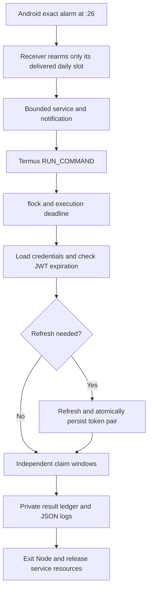

# Android architecture and validation

**Latest review:** [1.7-rc1 reliability audit](docs/RELIABILITY-AUDIT.md), [changes](docs/RELIABILITY-CHANGELOG.md), and [validation gate](docs/RELIABILITY-VALIDATION.md) supersede the initial review below where they differ. Physical long-idle reliability remains unverified.

For first-time installation, follow [README-mobile.md](README-mobile.md).

## Architecture review

Reviewed local commit `966f6c0`, verified against GitHub HEAD on 2026-11-05. The old flow was Termux:Boot → crond → shell → `index.js --once`. It already enabled TLS verification, had two windows, and used application `statusCode` to check acceptance. Problems found:

- Startup could use an expired token before refresh, or fall back to interactive OTP in cron.
- Token files were individually overwritten, allowing partial writes and mismatched rotated pairs.
- Network/5xx claim POST retries could repeat a request already accepted by the server.
- A mkdir lock survived SIGKILL/reboot and blocked all future executions.
- No persistent per-window outcome prevented repeat submissions after restart.
- Raw responses and account/proxy details appeared in logs. Missing `.gitignore` contradicted the old documentation.
- A late request could cross a window deadline; eligibility polling did not correctly respect its stated delay policy.
- Dependencies were unlocked. `proxies.txt` is already tracked; ignoring it does not untrack it.

The existing device/version headers and auth, eligibility, pre-claim advertisement, claim and post-claim advertisement endpoints remain. Their undocumented semantics have not been independently established. Do not change the headers to impersonate other accounts/devices or bypass server controls.

## Decision

Use six one-shot `AlarmManager.setExactAndAllowWhileIdle()` RTC alarms, registering six independent next-occurrence slots and rearming each delivered slot for the next day. The alarm receiver starts a bounded, visible `dataSync` foreground service that holds a timeout-limited CPU wake lock and invokes Termux's supported `RUN_COMMAND` service with background execution enabled. Termux runs the locked shell wrapper and exits Node after both windows, no later than :34. The result callback releases the companion service early; its deadline also releases resources if Termux never responds.



No cron, Node, or companion service is required between the six daily runs. **Node remains sleeping between the two windows in a single run.** Eliminating that short wait would require a second wakeup only five minutes later, which cannot be relied on in Doze. Android documents a minimum nine-minute spacing for allow-while-idle alarms. A single alarm's brief temporary exemption does not keep an eight-minute execution or another app's network access alive. For the proposed mode, manually exempt **both Termux and the companion** from battery optimization, and test OEM background/autostart settings. A foreground service alone does not bypass Doze. These are reliability accommodations, not guarantees. [Android Doze documentation](https://developer.android.com/training/monitoring-device-state/doze-standby)

Exact alarms need user-granted `SCHEDULE_EXACT_ALARM` access on supported Android versions; the app checks permission and rearms after grant. It deliberately does not use restricted `USE_EXACT_ALARM` or a fake alarm-clock UI. Exact alarms for user-requested actions can start foreground services, but cross-app Termux launch restrictions and OEM policy still apply. [Alarm scheduling](https://developer.android.com/develop/background-work/services/alarms), [foreground service restrictions](https://developer.android.com/develop/background-work/services/fgs/restrictions-bg-start)

### Alternatives

| Approach | Battery and timing | Decision |
|---|---|---|
| Cron | Idle daemon is small, but process survival and continuous wake locks are costly; no Android wake scheduling | Retain only as an optional fallback |
| WorkManager | OS batches work efficiently; periodic minimum is 15 minutes; one-time initial delay is not an exact deadline | Unsuitable for :26/:31 claim windows |
| Termux:API job scheduler | JobScheduler-backed, supports persisted jobs, but subject to deferral | Useful for flexible work, not this schedule |
| Exact-alarm companion | No between-run daemon; six wakeups, at most 48 minutes/day of bounded wake-lock time | Selected to preserve existing Node business logic |
| Fully native client | Removes Termux handoff and second app's lifecycle; requires porting authentication and API workflow | Better long-term control if device testing rejects the Termux bridge; still subject to Doze/force-stop |

[WorkManager timing](https://developer.android.com/develop/background-work/background-tasks/persistent/getting-started/define-work), [Termux job scheduler source](https://github.com/termux/termux-api-package/blob/master/scripts/termux-job-scheduler.in), [supported Termux integration](https://github.com/termux/termux-app/wiki/RUN_COMMAND-Intent)

### Phone lifecycle behavior

| User/system action | Expected behavior and limits |
|---|---|
| Press Home | UI goes into background; scheduled alarms remain |
| Swipe Termux from Recent Apps | Usually dismisses the activity; supported background command can start without opening a terminal. Some OEMs treat dismissal more aggressively; test the actual phone |
| Android kills process for memory | Companion alarms can survive process death and start a future run. An in-progress run may be lost; durable submission markers prevent repeating an uncertain POST |
| Force-stop Termux | Do not expect scheduled execution; manually reopen Termux before resuming |
| Force-stop companion | Its alarms cannot be relied upon and may be canceled; reopen it and select Enable / repair schedule |
| Reboot | Boot receiver rearms future alarms after normal unlock/credential-encrypted storage availability. No pre-unlock credential access. Missed slots are logged, not replayed |
| Time or timezone change | Receiver recalculates future local times. Active Node run stops further requests when a suspend-aware elapsed clock detects a timezone or >5-second wall-clock jump. Repeated local hour uses the same ledger key |

Force-stop is explicitly different from swiping away an activity. Android 15 cancels pending intents when an app enters the stopped state. Reboot is not a promised escape from force-stop. [Android stopped-state behavior](https://developer.android.com/about/versions/15/behavior-changes-all)

## Runtime behavior

Local hours: **01, 05, 09, 13, 17, 21**. First window `[26:00,30:00)` includes the entire :29 minute; second `[31:00,34:00)` stops at :34:00. Late delivery uses only the remaining window. Calls outside those hours/minutes exit immediately.

At startup:

1. Load `credentials.json`, or fall back to legacy `token.txt` and `refresh_token.txt` only if the new file does not exist.
2. Decode JWT `exp` locally. This checks lifetime, **not cryptographic authenticity**; the server remains authoritative.
3. A valid token proceeds. Expired/missing/malformed tokens, or tokens within five minutes of expiry, trigger `POST /auth/token` with the refresh token.
4. Verify the application success status and a usable, unexpired access token. Retain the old refresh token only if the server omits a replacement.
5. Atomically write the pair to one `credentials.json` using a 0600 temporary file, fsync, rename and directory fsync. Persistence failure prevents continuation.
6. Refresh failure records failure for unfinished windows and exits without OTP prompts. Use manual login to recover.

This single-file pair prevents a crash between two individual token-file renames from mixing token generations. Legacy files remain private migration inputs; new rotations are saved to `credentials.json`. Once migrated, it is authoritative. Token storage is private plaintext, not encryption against a rooted phone. Server-side refresh rotation followed by a crash before persistence can still require manual reauthentication; no local write strategy removes that server/client transaction gap.

Each window checks eligibility at most six times, with 30-second backoff; no rate-limit or authentication rejection is retried. Network/read failures are bounded. Every HTTP request has a 10-second timeout, clamped to the window deadline for claim work. No undocumented `nextFrame` units are assumed. A true eligibility result is required for submission. Pre-claim sequence retains the existing advertisement GET and 15-second pause.

A durable `submitted` marker is saved **before** the claim POST. Only one POST is permitted per window, even if the server rejects it or the result is ambiguous. This conservative policy can miss a legitimate retry but avoids duplicate non-idempotent requests. Success requires application `statusCode: 200` and `current-user-full.token.lastClaimTime` advancing from the pre-claim baseline. This is stronger than HTTP 200 alone, but the timestamp interpretation still needs live validation; concurrent claims from another client can confound attribution. Unknown outcomes are failures, never invented successes.

Results are `WINDOW_1_SUCCESS`, `WINDOW_1_NOT_ELIGIBLE`, `WINDOW_1_FAILED`, and corresponding `WINDOW_2_*`, with separate reason fields. `FAILED` with `submission_outcome_unknown` means the server **may** have accepted the claim. Do not clear the ledger to retry it. The scheduled maximum is 12 successes/day (separate manual claims are not included), subject to actual execution and server eligibility.

`flock` prevents overlapping shell runs and releases on process death. Scheduled launches must use `run-scheduled.sh`; manual launches must use `run-on-demand.sh`. Do not invoke the Node runners directly, because the wrappers hold the shared lock. Terminal authentication should happen with scheduling disabled and no active run. JSON-line logs are under `logs/`, and the private ledger is `.runtime/state.json`. Corrupt state fails closed. The ledger is not automatically pruned, preserving duplicate suppression when clocks move backward. Daily execution logs are pruned to today and yesterday at the next wrapper execution. Claim ledgers are never pruned by log cleanup.

## Files

```text
Interlink-Auto-Bot/
  index.js                  manual login, API headers, startup refresh and token persistence
  scheduled.js              bounded two-window runner, durable outcomes and JSON logs
  on-demand.js              immediate connection test or single eligible claim
  run-on-demand.sh           shared execution lock and on-demand log redirection
  lib/diagnostics.js         allowlisted error metadata without raw responses
  lib/eligibility.js         HTTP/application status and eligibility validation
  setup-termux.sh            first-time setup and credential-preserving upgrades
  lib/storage.js            atomic private writes; fail-closed JSON reads
  lib/log-retention.js      local-calendar cleanup of recognized daily logs
  lib/execution-clock.js    suspend-aware clock guard and bounded waits
  lib/windows.js            local schedule and conservative confirmation predicate
  run-scheduled.sh           kernel lock, timeout and private log redirection
  setup-schedule.sh          optional legacy cron installer
  package.json              commands and dependencies
  package-lock.json         resolved dependency versions
  test/                     mocked auth, state and window tests; no real claims
  android-companion/
    settings.gradle.kts     build repositories and app registration
    build.gradle.kts        pinned Android/Kotlin plugins
    app/build.gradle.kts    SDK 35, minimum Android 8, Java 17
    app/src/main/AndroidManifest.xml
    app/src/main/java/ai/interlink/scheduler/Scheduler.kt
                            alarm/recovery receivers, bounded service and callback
    app/src/main/java/ai/interlink/scheduler/MainActivity.kt
                            guided setup, permission status and local-time activity
    app/src/main/res/drawable/ic_launcher.xml
                            teal clock launcher icon
  .gitignore                credentials, runtime state, logs and build exclusions
  README-mobile.md          this review, installation and testing guide
```

## Testing and acceptance

Automated tests use fake time and mocked HTTP; they never call Interlink. Local verification used Node 26.5.0 (the user's reported 26.13.0 was not available here). Dependency installation on 2026-11-05 reported zero known vulnerabilities; this is not a permanent security guarantee.

| Test | Procedure | Acceptance |
|---|---|---|
| First window | Mock suite, then observe one real scheduled run | At most one POST, success only with verified advancement |
| Second window | Observe the same execution across :31 | Independent second result; first success does not exit early |
| Expired token | Mock expired JWT | Refresh precedes any reward request |
| Refresh rotation | Mock replacement refresh token and persistence failure | Pair saved together; failure stops execution |
| No refresh token / rejection | Mock missing/invalid refresh | Both unfinished windows fail, no OTP prompt |
| Screen locked / Doze | Leave unplugged/locked; optionally `adb shell dumpsys deviceidle force-idle` before a scheduled alarm | Observe dispatch and both results, then `adb shell dumpsys deviceidle unforce` |
| Recent Apps dismissed | Swipe Termux and companion away before a real alarm | Alarm can dispatch without opening terminal UI; document OEM failures |
| Reboot | Reboot, unlock, inspect companion next alarm | Future schedule restored; no replay of missed claims |
| Network unavailable | Disable network during a run | Bounded read retries; uncertain POST is never repeated |
| Duplicate execution | Start wrapper twice during a slot; run once again after completion | Kernel lock blocks concurrency; ledger prevents repeat POST |
| Process death | Kill a test execution after submission marker | Restart marks unknown outcome failed, no retry |
| Missed schedule | Delay delivery past :34 or reboot over a slot | Missed event logged, no catch-up API calls |
| Time/timezone | Change timezone before alarm and during a run | Future local alarm recalculated; old run stops new requests |
| Permission revocation | Revoke exact-alarm / Termux permission | Fail visibly; regrant and Enable / repair to recover |
| Force-stop | Force-stop each app separately | Do not expect execution; manually reopen and repair |
| Shutdown | Inspect after :34 and between runs | No Node process or companion execution service; no held companion wake lock |

Inspect `adb shell dumpsys alarm` for package `ai.interlink.scheduler`; inspect `adb shell dumpsys power` for wake locks. Companion events distinguish dispatch from completed commands. Inspect private `logs/claim-YYYY-MM-DD.log` and `.runtime/state.json` in Termux for actual claim outcomes. Do not share unredacted token files or full account responses.

Android compilation and lint completed successfully. Callback delivery, reboot, locked-screen, OEM swipe behavior, and the live API confirmation contract remain **unverified**. Do not infer success from the companion's dispatch message. A frozen/killed process cannot write a final result at that moment; the companion detects an overdue future schedule on recovery and an existing submission marker protects later restarts.

## Final comparison

| Criteria | Existing cron | Proposed Android companion |
|---|---|---|
| Battery consumption | Small idle daemon, potentially continuous wake-lock workaround | Six alarms; bounded service and wake lock, up to 48 min/day; real savings require measurement |
| Background reliability | Depends on surviving Termux/daemon | OS holds future alarms; Termux handoff and OEM restrictions remain |
| Exact scheduling | Minute cron tick only while CPU/process available | Exact-alarm access, still subject to OS restrictions and delivery delays |
| Termux UI closed | May continue if process survives | Background RUN_COMMAND can start without a terminal UI |
| Force-stop behavior | No reliable execution | No reliable execution; reopen/repair required |
| Reboot recovery | Termux:Boot must start daemon | Companion boot receiver rearms after unlock |
| Implementation complexity | Low | Higher: Android app, permissions, service, callback, Node ledger |
| Maintenance | Shell/Node/cron | Android target/build/permissions plus Node dependencies and API contracts |

A native API client would reduce integration failure points if Termux dispatch fails on the target phone. It would still need an honest user-visible background-execution design and could not promise execution after force-stop.

## Regression coverage for the overnight failures

The reported 01:30:33 false missed-window result is reproduced using injected wall and suspend-aware clocks. Tests require waiting until 01:31 and checking eligibility, rather than terminating. Other cases cover waking after the real deadline without any requests, clock adjustments, timezone changes, and finishing a bounded wait on the first callback after a long suspension.

Android unit tests cover six independent local alarm times, delayed delivery, exact end boundaries, midnight, DST, elapsed-realtime deadlines and mode-specific completion descriptions. Instrumented tests exercise actual receiver/recovery code, duplicate and delayed delivery, callback isolation, boot/timezone recovery, and an OS-delivered alarm with an expired payload that cannot launch claims. An opt-in Doze test is run separately to avoid repeated idle alarms conflicting with Android's per-app quotas. No live account is used by these tests.

Sources for clock semantics: [libuv Linux uptime implementation](https://github.com/libuv/libuv/blob/v1.x/src/unix/linux.c), [Linux CLOCK_BOOTTIME and CLOCK_MONOTONIC](https://man7.org/linux/man-pages/man2/clock_gettime.2.html).


### Version 1.6 recovery and diagnostic changes

Foreground opening/manual repair dispatches an undelivered slot only within its original eight-minute lifetime. It preserves the intended timestamp and distinguishes recovery from OS delivery; subsequent callbacks for the replaced slot are rejected. The existing shell lock and Node ledger remain the claim-level duplicate barriers. Background recovery only rearms future alarms.

`BackgroundTest.kt` provides an independent, cancellable two-minute exact alarm with a separate PendingIntent identity. Its receiver records lateness, rejects expired/busy execution and invokes only connection-test mode through RunService. Daily alarm registration is not altered. Device/API level, power state, registration acceptance and service entry are included in diagnostics. Exact-alarm capability may be provided by power-save exemption, so UI text does not equate it with a user-granted Settings toggle.

See `android-companion/releases/VALIDATION-1.6.md` for actual validation and unresolved device limitations.
