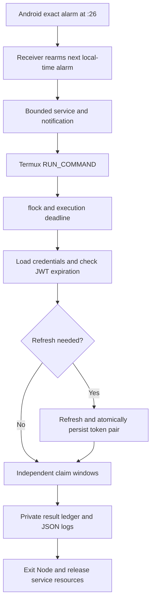

# Android scheduling redesign

Status: Node tests pass; Android companion source provided, **not built or tested on a phone** in this environment. No live Interlink requests were made. Review and complete the acceptance tests below before relying on unattended claims.

## Architecture review

Reviewed local commit `966f6c0`, verified against GitHub HEAD on 2026-11-05. The old flow was Termux:Boot → crond → shell → `index.js --once`. It already enabled TLS verification, had two windows, and used application `statusCode` to check acceptance. Problems found:

- Startup could use an expired token before refresh, or fall back to interactive OTP in cron.
- Token files were individually overwritten, allowing partial writes and mismatched rotated pairs.
- Network/5xx claim POST retries could repeat a request already accepted by the server.
- A mkdir lock survived SIGKILL/reboot and blocked all future executions.
- No persistent per-window outcome prevented repeat submissions after restart.
- Raw responses and account/proxy details appeared in logs. Missing `.gitignore` contradicted the old documentation.
- A late request could cross a window deadline; eligibility polling did not correctly respect its stated delay policy.
- Dependencies were unlocked. `proxies.txt` is already tracked; ignoring it does not untrack it.

The existing device/version headers and auth, eligibility, pre-claim advertisement, claim and post-claim advertisement endpoints remain. Their undocumented semantics have not been independently established. Do not change the headers to impersonate other accounts/devices or bypass server controls.

## Decision

Use six one-shot `AlarmManager.setExactAndAllowWhileIdle()` RTC alarms, rearming the next alarm before dispatch. The alarm receiver starts a bounded, visible `dataSync` foreground service that holds a timeout-limited CPU wake lock and invokes Termux's supported `RUN_COMMAND` service with background execution enabled. Termux runs the locked shell wrapper and exits Node after both windows, no later than :34. The result callback releases the companion service early; its deadline also releases resources if Termux never responds.



No cron, Node, or companion service is required between the six daily runs. **Node remains sleeping between the two windows in a single run.** Eliminating that short wait would require a second wakeup only five minutes later, which cannot be relied on in Doze. Android documents a minimum nine-minute spacing for allow-while-idle alarms. A single alarm's brief temporary exemption does not keep an eight-minute execution or another app's network access alive. For the proposed mode, manually exempt **both Termux and the companion** from battery optimization, and test OEM background/autostart settings. A foreground service alone does not bypass Doze. These are reliability accommodations, not guarantees. [Android Doze documentation](https://developer.android.com/training/monitoring-device-state/doze-standby)

Exact alarms need user-granted `SCHEDULE_EXACT_ALARM` access on supported Android versions; the app checks permission and rearms after grant. It deliberately does not use restricted `USE_EXACT_ALARM` or a fake alarm-clock UI. Exact alarms for user-requested actions can start foreground services, but cross-app Termux launch restrictions and OEM policy still apply. [Alarm scheduling](https://developer.android.com/develop/background-work/services/alarms), [foreground service restrictions](https://developer.android.com/develop/background-work/services/fgs/restrictions-bg-start)

### Alternatives

| Approach | Battery and timing | Decision |
|---|---|---|
| Cron | Idle daemon is small, but process survival and continuous wake locks are costly; no Android wake scheduling | Retain only as an optional fallback |
| WorkManager | OS batches work efficiently; periodic minimum is 15 minutes; one-time initial delay is not an exact deadline | Unsuitable for :26/:31 claim windows |
| Termux:API job scheduler | JobScheduler-backed, supports persisted jobs, but subject to deferral | Useful for flexible work, not this schedule |
| Exact-alarm companion | No between-run daemon; six wakeups, at most 48 minutes/day of bounded wake-lock time | Selected to preserve existing Node business logic |
| Fully native client | Removes Termux handoff and second app's lifecycle; requires porting authentication and API workflow | Better long-term control if device testing rejects the Termux bridge; still subject to Doze/force-stop |

[WorkManager timing](https://developer.android.com/develop/background-work/background-tasks/persistent/getting-started/define-work), [Termux job scheduler source](https://github.com/termux/termux-api-package/blob/master/scripts/termux-job-scheduler.in), [supported Termux integration](https://github.com/termux/termux-app/wiki/RUN_COMMAND-Intent)

### Phone lifecycle behavior

| User/system action | Expected behavior and limits |
|---|---|
| Press Home | UI goes into background; scheduled alarms remain |
| Swipe Termux from Recent Apps | Usually dismisses the activity; supported background command can start without opening a terminal. Some OEMs treat dismissal more aggressively; test the actual phone |
| Android kills process for memory | Companion alarms can survive process death and start a future run. An in-progress run may be lost; durable submission markers prevent repeating an uncertain POST |
| Force-stop Termux | Do not expect scheduled execution; manually reopen Termux before resuming |
| Force-stop companion | Its alarms cannot be relied upon and may be canceled; reopen it and select Enable / repair schedule |
| Reboot | Boot receiver rearms future alarms after normal unlock/credential-encrypted storage availability. No pre-unlock credential access. Missed slots are logged, not replayed |
| Time or timezone change | Receiver recalculates future local times. Active Node run stops further requests when it detects a timezone or >5-second clock jump. Repeated local hour uses the same ledger key |

Force-stop is explicitly different from swiping away an activity. Android 15 cancels pending intents when an app enters the stopped state. Reboot is not a promised escape from force-stop. [Android stopped-state behavior](https://developer.android.com/about/versions/15/behavior-changes-all)

## Runtime behavior

Local hours: **01, 05, 09, 13, 17, 21**. First window `[26:00,30:00)` includes the entire :29 minute; second `[31:00,34:00)` stops at :34:00. Late delivery uses only the remaining window. Calls outside those hours/minutes exit immediately.

At startup:

1. Load `credentials.json`, or fall back to legacy `token.txt` and `refresh_token.txt` only if the new file does not exist.
2. Decode JWT `exp` locally. This checks lifetime, **not cryptographic authenticity**; the server remains authoritative.
3. A valid token proceeds. Expired/missing/malformed tokens, or tokens within five minutes of expiry, trigger `POST /auth/token` with the refresh token.
4. Verify the application success status and a usable, unexpired access token. Retain the old refresh token only if the server omits a replacement.
5. Atomically write the pair to one `credentials.json` using a 0600 temporary file, fsync, rename and directory fsync. Persistence failure prevents continuation.
6. Refresh failure records failure for unfinished windows and exits without OTP prompts. Use manual login to recover.

This single-file pair prevents a crash between two individual token-file renames from mixing token generations. Legacy files remain private migration inputs; new rotations are saved to `credentials.json`. Once migrated, it is authoritative. Token storage is private plaintext, not encryption against a rooted phone. Server-side refresh rotation followed by a crash before persistence can still require manual reauthentication; no local write strategy removes that server/client transaction gap.

Each window checks eligibility at most six times, with 30-second backoff; no rate-limit or authentication rejection is retried. Network/read failures are bounded. Every HTTP request has a 10-second timeout, clamped to the window deadline for claim work. No undocumented `nextFrame` units are assumed. A true eligibility result is required for submission. Pre-claim sequence retains the existing advertisement GET and 15-second pause.

A durable `submitted` marker is saved **before** the claim POST. Only one POST is permitted per window, even if the server rejects it or the result is ambiguous. This conservative policy can miss a legitimate retry but avoids duplicate non-idempotent requests. Success requires application `statusCode: 200` and `current-user-full.token.lastClaimTime` advancing from the pre-claim baseline. This is stronger than HTTP 200 alone, but the timestamp interpretation still needs live validation; concurrent claims from another client can confound attribution. Unknown outcomes are failures, never invented successes.

Results are `WINDOW_1_SUCCESS`, `WINDOW_1_NOT_ELIGIBLE`, `WINDOW_1_FAILED`, and corresponding `WINDOW_2_*`, with separate reason fields. `FAILED` with `submission_outcome_unknown` means the server **may** have accepted the claim. Do not clear the ledger to retry it. Maximum is 12 successes/day, subject to actual execution and server eligibility.

`flock` prevents overlapping shell runs and releases on process death. All production launches must use `run-scheduled.sh`; do not launch `scheduled.js` directly. Terminal authentication should happen with scheduling disabled and no active run. JSON-line logs are under `logs/`, and the private ledger is `.runtime/state.json`. Corrupt state fails closed. The ledger is not automatically pruned, preserving duplicate suppression when clocks move backward. Review/archive logs periodically if storage is limited.

## Files

```text
Interlink-Auto-Bot/
  index.js                  manual login, API headers, startup refresh and token persistence
  scheduled.js              bounded two-window runner, durable outcomes and JSON logs
  lib/storage.js            atomic private writes; fail-closed JSON reads
  lib/windows.js            local schedule and conservative confirmation predicate
  run-scheduled.sh           kernel lock, timeout and private log redirection
  setup-schedule.sh          optional legacy cron installer
  package.json              commands and dependencies
  package-lock.json         resolved dependency versions
  test/                     mocked auth, state and window tests; no real claims
  android-companion/
    settings.gradle.kts     build repositories and app registration
    build.gradle.kts        pinned Android/Kotlin plugins
    app/build.gradle.kts    SDK 35, minimum Android 8, Java 17
    app/src/main/AndroidManifest.xml
    app/src/main/java/ai/interlink/scheduler/Scheduler.kt
                            UI, alarm/recovery receivers, bounded service and callback
  .gitignore                credentials, runtime state, logs and build exclusions
  README-mobile.md          this review, installation and testing guide
```

## Installation and migration

### Review and publish from the Mac

No commit or push was performed by this implementation task. Review the changes, then publish your chosen branch:

```sh
cd /Users/harikorivi/Downloads/Helping_hands
 git diff --check
 git diff -- Interlink-Auto-Bot
cd Interlink-Auto-Bot
npm ci --ignore-scripts
npm test
npm audit
cd ..
git add Interlink-Auto-Bot/index.js Interlink-Auto-Bot/scheduled.js Interlink-Auto-Bot/lib Interlink-Auto-Bot/test Interlink-Auto-Bot/android-companion Interlink-Auto-Bot/.gitignore Interlink-Auto-Bot/package.json Interlink-Auto-Bot/package-lock.json Interlink-Auto-Bot/run-scheduled.sh Interlink-Auto-Bot/README.md Interlink-Auto-Bot/README-mobile.md
git diff --cached --stat
git commit -m "Add Android alarm scheduler and secure bounded claim execution"
git push origin HEAD
```

Do not use `git add .` for credential-bearing workspaces. `proxies.txt` was already tracked before these changes: keep any real proxy credentials out of that file, or explicitly untrack it before adding credentials. No credential file contents were inspected during this task.

### Build the companion on the Mac

Install Android Studio/SDK 35 and JDK 17. Open `android-companion` as a Gradle project. Use Gradle **8.9**, compatible with AGP **8.7.3**. This source does not bundle a Gradle wrapper binary. With Gradle 8.9 installed:

```sh
cd /Users/harikorivi/Downloads/Helping_hands/Interlink-Auto-Bot/android-companion
gradle :app:assembleDebug :app:lintDebug
adb install -r app/build/outputs/apk/debug/app-debug.apk
```

For long-term installation, create a privately stored release signing key and signed APK using Android Studio; retain that key for upgrades. This is a personal sideload implementation, not a claim of Play Store eligibility. [Build tool compatibility](https://developer.android.com/build/releases/agp-8-7-0-release-notes)

### Configure Termux

Use a supported Termux build with the documented `RUN_COMMAND` API (introduced in 0.95; callbacks require at least 0.109; use a maintained release). Install Termux and its add-ons from a consistent signing source if using add-ons. The bridge does not need Termux:API, Tasker, or Termux:Boot. Google Play and other Termux variants may differ; validate the installed build, Android version and OEM before declaring compatibility.

```sh
pkg install nodejs-lts git util-linux coreutils
cd ~/Helping_hands
git pull --ff-only
cd Interlink-Auto-Bot
npm ci --ignore-scripts
chmod 700 run-scheduled.sh
mkdir -p ~/.termux
```

Edit `~/.termux/termux.properties` to contain a single active setting:

```properties
allow-external-apps=true
```

Then run `termux-reload-settings`. Only grant Termux command permission to apps you trust: it allows execution in the Termux environment. The fixed companion path is `~/Helping_hands/Interlink-Auto-Bot`; change the `work` path in `Scheduler.kt` and rebuild if your checkout differs.

Disable the old tagged cron entry while preserving other jobs:

```sh
if crontab -l > "$TMPDIR/interlink-crontab-before" 2>/dev/null; then
  sed '/# interlink-scheduled-claim/d' "$TMPDIR/interlink-crontab-before" | crontab -
fi
```

Remove the old Interlink-only `crond` startup command from the relevant `~/.termux/boot/` script. If crond serves no other jobs, stop it with `pkill -x crond`. Do not disable unrelated cron jobs or boot scripts. Do not reinstall `setup-schedule.sh` while using the companion.

Authenticate manually with the companion disabled and no active run:

```sh
cd ~/Helping_hands/Interlink-Auto-Bot
node index.js --login
npm test
```

Passcode and OTP input are hidden. Manual login saves the pair atomically; future executions refresh automatically. Keep Termux data inside its private home, not shared Android storage. Never set `NODE_TLS_REJECT_UNAUTHORIZED=0`.

Open **Interlink Scheduler**. Grant command execution and notification permissions, grant Alarms & reminders access, then manually exempt both apps under Battery settings. Select **Enable / repair schedule** and verify the next local-time alarm. Keep notifications enabled so a bounded run is visible. OEM autostart settings may also be required. Open Termux and the companion at least once after installation. No terminal session needs to remain open between runs.

## Testing and acceptance

Automated tests use fake time and mocked HTTP; they never call Interlink. Local verification used Node 26.5.0 (the user's reported 26.13.0 was not available here). Dependency installation on 2026-11-05 reported zero known vulnerabilities; this is not a permanent security guarantee.

| Test | Procedure | Acceptance |
|---|---|---|
| First window | Mock suite, then observe one real scheduled run | At most one POST, success only with verified advancement |
| Second window | Observe the same execution across :31 | Independent second result; first success does not exit early |
| Expired token | Mock expired JWT | Refresh precedes any reward request |
| Refresh rotation | Mock replacement refresh token and persistence failure | Pair saved together; failure stops execution |
| No refresh token / rejection | Mock missing/invalid refresh | Both unfinished windows fail, no OTP prompt |
| Screen locked / Doze | Leave unplugged/locked; optionally `adb shell dumpsys deviceidle force-idle` before a scheduled alarm | Observe dispatch and both results, then `adb shell dumpsys deviceidle unforce` |
| Recent Apps dismissed | Swipe Termux and companion away before a real alarm | Alarm can dispatch without opening terminal UI; document OEM failures |
| Reboot | Reboot, unlock, inspect companion next alarm | Future schedule restored; no replay of missed claims |
| Network unavailable | Disable network during a run | Bounded read retries; uncertain POST is never repeated |
| Duplicate execution | Start wrapper twice during a slot; run once again after completion | Kernel lock blocks concurrency; ledger prevents repeat POST |
| Process death | Kill a test execution after submission marker | Restart marks unknown outcome failed, no retry |
| Missed schedule | Delay delivery past :34 or reboot over a slot | Missed event logged, no catch-up API calls |
| Time/timezone | Change timezone before alarm and during a run | Future local alarm recalculated; old run stops new requests |
| Permission revocation | Revoke exact-alarm / Termux permission | Fail visibly; regrant and Enable / repair to recover |
| Force-stop | Force-stop each app separately | Do not expect execution; manually reopen and repair |
| Shutdown | Inspect after :34 and between runs | No Node process or companion execution service; no held companion wake lock |

Inspect `adb shell dumpsys alarm` for package `ai.interlink.scheduler`; inspect `adb shell dumpsys power` for wake locks. Companion events distinguish dispatch from completed commands. Inspect private `logs/claim-YYYY-MM-DD.log` and `.runtime/state.json` in Termux for actual claim outcomes. Do not share unredacted token files or full account responses.

Android compilation/lint, callback delivery, reboot, locked-screen, OEM swipe behavior, and the live API confirmation contract remain **unverified**. Do not infer success from the companion's dispatch message. A frozen/killed process cannot write a final result at that moment; the companion detects an overdue future schedule on recovery and an existing submission marker protects later restarts.

## Final comparison

| Criteria | Existing cron | Proposed Android companion |
|---|---|---|
| Battery consumption | Small idle daemon, potentially continuous wake-lock workaround | Six alarms; bounded service and wake lock, up to 48 min/day; real savings require measurement |
| Background reliability | Depends on surviving Termux/daemon | OS holds future alarms; Termux handoff and OEM restrictions remain |
| Exact scheduling | Minute cron tick only while CPU/process available | Exact-alarm access, still subject to OS restrictions and delivery delays |
| Termux UI closed | May continue if process survives | Background RUN_COMMAND can start without a terminal UI |
| Force-stop behavior | No reliable execution | No reliable execution; reopen/repair required |
| Reboot recovery | Termux:Boot must start daemon | Companion boot receiver rearms after unlock |
| Implementation complexity | Low | Higher: Android app, permissions, service, callback, Node ledger |
| Maintenance | Shell/Node/cron | Android target/build/permissions plus Node dependencies and API contracts |

A native API client would reduce integration failure points if Termux dispatch fails on the target phone. It would still need an honest user-visible background-execution design and could not promise execution after force-stop.
