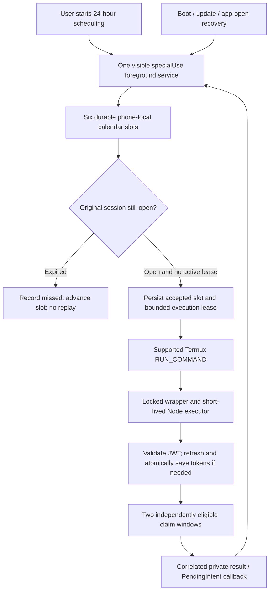

# ADR: One continuous foreground scheduling service

Date: 2026-11-07. Status: implemented in 2.0-rc1, hardened in 2.0-rc2; physical-device acceptance pending.

[12 November evidence and recovery changes](TASK-REMOVAL-REVIEW-2026-11-12.md).

## Context

The user now accepts a continuous background process and its battery cost. Android remains the execution target; the Mac builds the APK. Previous designs mixed six AlarmManager deliveries, a persistent monitor, a separate bounded execution service and diagnostic experiments. Physical exports show both late deliveries and OEM-requested process termination. Those are separate failure domains. The earlier [architecture review](ADR-ANDROID-RELIABILITY-REVIEW.md) remains historical evidence; its default-off continuous-mode recommendation is superseded by the user's changed requirement.

## Options and decision

| Option | Benefit | Cost / limitation | Decision |
|---|---|---|---|
| Alarm-only companion | No resident CPU wake lock | Delivery/startup delays already observed | Retire as active execution mode |
| Cron and a Termux wake lock | Fewer Android components | Moves resident scheduling into shell; weaker companion observability; same Termux/OEM limits | Not selected |
| One companion foreground service, existing Node executor | One owner for scheduling, session state and callback lifetime; preserves legitimate API workflow | Continuous CPU wake lock; Termux remains a second package | Selected under revised battery requirement |
| Fully native API client | Removes Termux bridge | Porting/authentication parity risk; still subject to package force-stop | Deferred |
| Always-on external host | Independent of this phone's lifecycle | Changes deployment, credential location and availability requirements | Not selected |

`RunService` is the only foreground service. It starts in response to the user's Start action, remains visibly active, holds one partial wake lock, and evaluates six durable local-calendar slots. It uses a HandlerThread and a maximum 30-second idle clock-check interval with a minute status heartbeat, shortening the next callback to the original due time. Logging/device sampling uses a separate executor and cannot delay foreground promotion or scheduling. Node does not stay resident between sessions. While the service is alive with CPU wakefulness, timer delivery does not depend on AlarmManager starting a closed activity.

The service is declared `specialUse` with an explicit subtype for user-enabled continuous precise scheduling. It is not a permanently running `dataSync` service or a three-minute `shortService`. This declaration does not exempt it from OEM process management. Public distribution through Google Play would require its own policy review; this repository supplies a personal sideloaded build. [Android service types](https://developer.android.com/develop/background-work/services/fgs/service-types), [Android 15 foreground-service limits](https://developer.android.com/develop/background-work/services/fgs/timeout).

No AlarmManager, exact-alarm permission, full-screen intent, notification-listener/accessibility privilege, silent audio, wake-lock cycling, or system-package disabling is used for execution. Migration cancels only the old known Interlink alarm identities and retires their UI/configuration. This cannot erase the private Node ledger or credentials.

## Runtime contract

- Daily starts: 01:26, 05:26, 09:26, 13:26, 17:26 and 21:26 in the current phone timezone. These are calendar slots, not intervals measured from prior completion. DST/calendar changes recalculate future times.
- Original windows remain `[26:00,30:00)` and `[31:00,34:00)`. A late restart can use remaining time only; expired opportunities are not replayed. Node independently enforces windows, lock, ledger, eligibility, API acceptance and advancing claim timestamp.
- A durable per-hour accepted epoch prevents resubmitting the same session after callback loss or process restart. An existing lease is recovered as unknown and awaited until its original wall/elapsed deadline; it is never blindly dispatched again. Reboot invalidates a prior monotonic lease and records its unknown outcome rather than applying an old boot's elapsed clock.
- Continuous scheduling holds its wake lock between sessions. Manual runs while scheduling is paused use a deadline-limited lock. Pause leaves an in-progress execution enough time to finish within its original deadline, then releases the service resources.
- A callback clears only its matching lease. Old/duplicate callbacks cannot stop the continuous service, clear another execution or overwrite a newer manual result. A callback without a valid correlated Node report never means two successful claims.
- Termux dispatch is on a separate single executor. Startup bootstrap checks wrapper protocol 2, fixed path, dependencies and executables before claims. Raw command stdout/stderr are not imported into diagnostics; only the bounded validated report is parsed.
- Node's startup refresh, 0600 atomic token-pair storage, TLS verification, shared shell lock and persistent submission markers are preserved. No login prompts occur unattended; failed refresh exits with safe diagnostics.
- Structured evidence records process start elapsed time, foreground promotion, timer intended/actual time, dispatch, safe Node events, independent outcomes and lifecycle/power observations. Sampling/storage timestamps are distinct from event timestamps. The service retains a minute heartbeat, not continuous network polling.

## Lifecycle boundary

| Action | Expected behavior |
|---|---|
| Home / screen locked | UI is unnecessary; service and CPU wake lock remain active |
| Swipe Scheduler from Recents | `stopWithTask=false`; record task removal and continue. OEM policy may still intervene |
| Swipe Termux UI | Background supported commands do not require a terminal activity, subject to Termux/OEM state |
| Ordinary memory-pressure process death | `START_STICKY` requests best-effort restart; recover durable plan/lease. No timing guarantee |
| Force-stop either package, including a recorded OEM-requested stop | No ordinary APK can guarantee restart while the package remains stopped; user must reopen it |
| Reboot | Boot receiver requests the enabled specialUse service after normal unlock, subject to Android restrictions; expired runs remain missed |
| Clock/timezone change | Recompute future calendar slots; active execution retains its original deadlines and Node's clock-change protections |

A foreground service and partial wake lock are not a privileged permanent process. Android's battery exemption and OEM behavior are separate. An emulator lacks `com.vivo.abe`; passing emulator tests cannot certify vivo survival. [Foreground launch rules](https://developer.android.com/develop/background-work/services/fgs/launch), [stopped-state behavior](https://developer.android.com/about/versions/15/behavior-changes-all).

## Verification and release gate

[Release validation](../android-companion/releases/VALIDATION-2.0-rc2.md) records executed tests. Local tests use intercepted Termux dispatches and synthetic report fixtures; they submit no real claims. The physical acceptance gate remains at least 48 hours with 12 due sessions, locked/overnight coverage, accounted-for stage evidence, bounded battery impact, no duplicate/out-of-window POSTs, and two confirmations whenever the server provides two eligible opportunities. This release removes identified application-owned lifecycle conflicts; it does not declare that gate passed.
